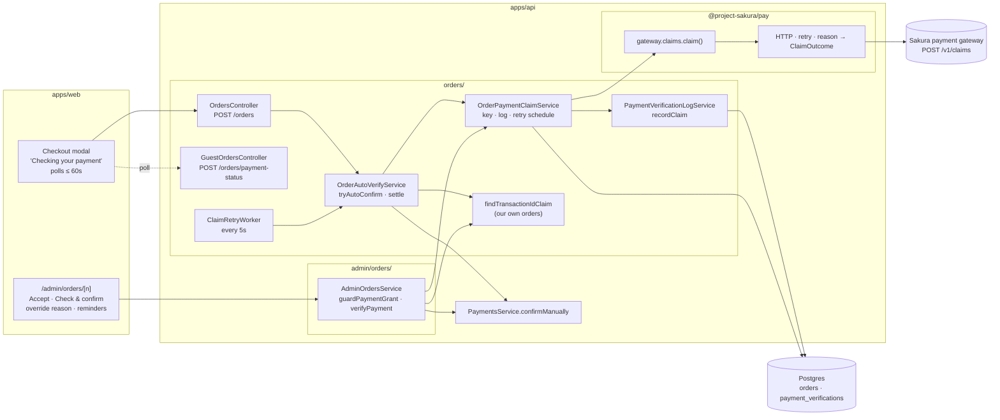
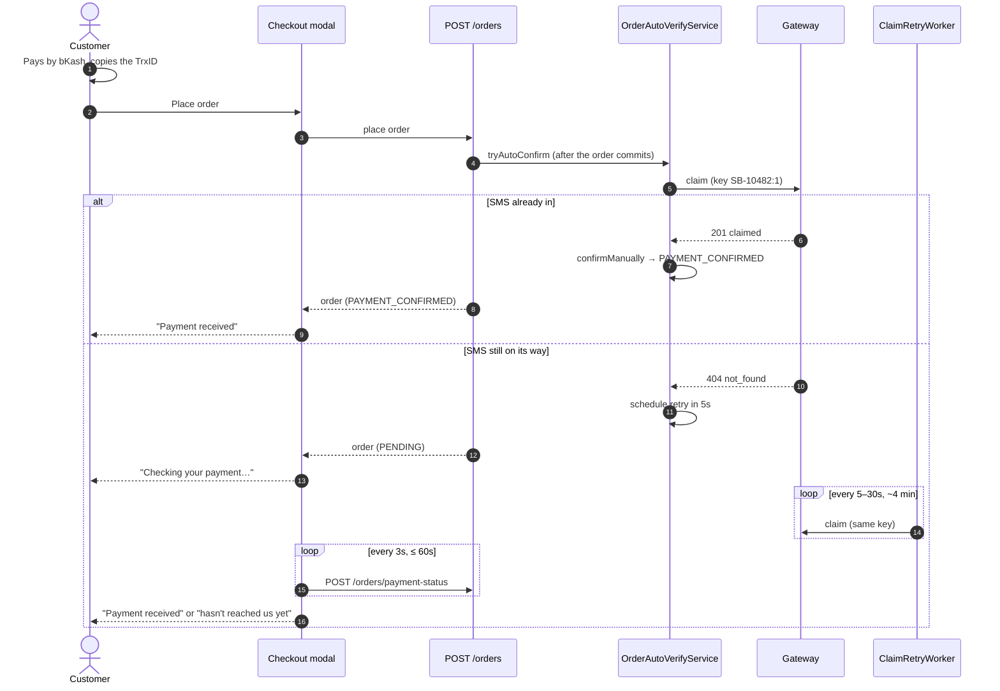

# Payment gateway claims

How sakura-book confirms bKash / Nagad / Rocket payments: by **claiming** each payment at the
Sakura payment gateway, once, across every business that shares the receiving number. This
replaced reading the gateway's MongoDB directly. Companion to
[backend-architecture.md](./backend-architecture.md).

Branch: `sakura-payment-gateway-integration` (based on `deployment`). Three commits:

| Commit    | Phase | What                                                             |
| --------- | ----- | ---------------------------------------------------------------- |
| `a45d310` | 1     | `payment-gateway` module, env vars, contract outcomes, migration |
| `60f9297` | 2     | Checkout, admin desk and retry worker switched to claims; web UI |
| `9984ecd` | 3     | MongoDB read path, `MONGO_URI` and the `mongodb` package removed |

---

## 1. Why

One receiving number collects money for several businesses. The old code asked the gateway's
database "does payment `trxId` exist for at least ৳X?". That question can't stop a second
business, or a second order, from using the same payment. The connection string was also far
more powerful than any credential the gateway issues.

The gateway now offers one endpoint, `POST /v1/claims`: "let me spend payment `trxId` for this
order." It says yes **once per payment, across every business**. There is no list, search or
"is it paid?" read. **Claiming is checking.** Don't build a read-then-claim flow on top of it.

---

## 2. Components



**Boundaries**

- [`@project-sakura/pay`](https://www.npmjs.com/package/@project-sakura/pay) is the only code
  that knows the gateway exists. sakura-book builds one client from its env in
  [`payment-gateway.provider.ts`](../apps/api/src/orders/payment-gateway.provider.ts) (the only
  caller of `createGatewayClient`). The package speaks poisha to callers and taka to the gateway,
  and gateway `reason` strings never leave it. It **never changes orders** and **never throws**:
  every failure comes back as an outcome. See [sakura-pay-migration.md](sakura-pay-migration.md)
  for the exact boundary.
- [`OrderPaymentClaimService`](../apps/api/src/orders/order-payment-claim.service.ts) is the
  orders-side wrapper every caller goes through. It picks the claim key, logs the attempt and
  schedules the next retry. It doesn't grant orders.
- Granting always goes through `PaymentsService.confirmManually`, the same door as before.

---

## 3. The outcomes

The gateway's reason codes are translated inside `@project-sakura/pay` into its `ClaimOutcome`
type. The outcome names live in `@sakura/contracts` (`paymentVerificationOutcomes`), so the admin panel uses the
same words.

| Gateway answer                                                                                      | `ClaimOutcome`    | Checkout / worker           | Admin confirm                 |
| --------------------------------------------------------------------------------------------------- | ----------------- | --------------------------- | ----------------------------- |
| 201 / 200 `claimed: true`                                                                           | `CLAIMED`         | Grant the order             | Grant                         |
| 404 `not_found`                                                                                     | `PENDING_ARRIVAL` | Stay PENDING, retry         | Needs a reason                |
| 422 `amount_mismatch`                                                                               | `UNDERPAID`       | Stay PENDING                | **Refused**                   |
| 409 `already_claimed`                                                                               | `ALREADY_CLAIMED` | Stay PENDING                | **Refused**                   |
| 409 `claim_released`                                                                                | `RELEASED`        | New key, no auto-retry      | New key, claims again at once |
| `ambiguous_trx`, `outside_claim_window`, `exceeds_max_claim`, `sender_mismatch`                     | `REJECTED`        | Stay PENDING                | Needs a reason                |
| `invalid_request`, `idempotency_key_reused`, `unauthenticated`, `client_inactive`, anything unknown | `MISCONFIGURED`   | Stay PENDING, logged loudly | Needs a reason                |
| network error, timeout, 5xx, 429 `rate_limited`, gateway not configured                             | `UNAVAILABLE`     | Stay PENDING, retry         | Needs a reason                |

Rules worth knowing:

- **Never grant on an answer we don't understand.** An unknown refusal is `MISCONFIGURED`; a
  "claimed" body with missing fields is `UNAVAILABLE` (retrying with the same key replays it).
- **Second look on amounts.** A `CLAIMED` answer whose amount is below the order total is turned
  into `UNDERPAID` on our side.
- **Ambiguous wallet.** The first claim is sent _without_ `platform`, so a customer who picked
  the wrong wallet on the form isn't stuck with "not found" forever. Only on `ambiguous_trx` is
  it resent once with the order's `provider`.
- **Payer's phone.** Every claim sends `senderPhone` as `01XXXXXXXXX` (the gateway has "require
  sender match" on for sakura-book and compares the last 10 digits). Checkout accepts the number
  loosely, normalises it with `normaliseBdPhone` (`@sakura/contracts`), refuses anything that isn't
  `^01[3-9]\d{8}$`, and stores the normalised form in `orders.sender_number`. Older orders with an
  unrecognised number send its bare digits, so the gateway answers `sender_mismatch` rather than
  "senderPhone is required".
- **Money.** The package takes `expectedPoisha` and returns `paidPoisha` / `overpaidPoisha`.
  Poisha and our cents are the same number, so `order.totalCents` passes straight in. Stored
  rows (`paid_cents`, `expected_cents`, `PaymentVerificationRecord`) keep the `…Cents` names.
- Older history rows still read `MATCHED` / `NOT_FOUND` from the Mongo days. They're kept in
  the enum so that history still parses.

---

## 4. The claim key

Every claim carries an idempotency key, `<orderNumber>:<attempt>`. The format comes from
`firstClaimKey` / `claimKeyFor` / `nextClaimKey` in `@project-sakura/pay`; which key is stored on
the order is decided in
[`order-payment-claim.service.ts`](../apps/api/src/orders/order-payment-claim.service.ts).

- Set to `:1` when a manual-transfer order with a transaction ID is placed
  (`orders.payment_claim_key`).
- Orders placed before this feature have no key stored. They get `:1` the first time they're
  claimed, and it's saved then. No backfill is needed.
- **The same key is reused on every retry.** A retry with the same key returns our own earlier
  success (`200`, `replay: true`). A retry with a new key would collide with our own claim and
  come back `already_claimed`, which looks like theft.
- **The key changes only on `RELEASED`** (a gateway admin let our claim go).
- **Not on reopen.** If a cancelled order had already claimed its payment, the claim is still
  ours and the same key gets it back. A new key would collide with it. _(This differs from the
  integration guide, which says to bump on reopen; see §10.)_
- **The key also changes when staff correct the transaction ID** (§7). The gateway refuses a
  key it has seen with a different ID (`idempotency_key_reused`).

---

## 5. Checkout and the customer's screen



- The checkout request makes **one** claim and returns. The package retries once inside that
  call on a network error, timeout or 5xx (same key), capped at 8 s in all. It never blocks while
  polling, and a gateway outage never fails a checkout: the order stays PENDING.
- The modal ([`wait-for-payment.ts`](../apps/web/src/components/checkout/wait-for-payment.ts))
  stays on "Checking your payment" and re-reads the order every 3 s for up to 60 s. It reads
  through `POST /orders/payment-status`, which needs order number **and** email, has a 30/min
  limit, and never calls the gateway itself.
- The copy was updated in English, Bangla and Japanese (`checkout.verify.*`).
- **A copied label is removed from the transaction ID** before it's checked or stored:
  `TrxID ABC123`, `TxnID: …`, `Transaction ID - …`, a Bangla label, and surrounding punctuation.
  Bangla digits become Latin. See `cleanTransactionId` in
  [`transaction-id.ts`](../packages/contracts/src/transaction-id.ts). Only a whole label word is
  removed, so an ID that starts with `TXN…` is left alone.
- Purchase analytics still fire the moment the order exists, not after the wait.

---

## 6. The retry worker

[`claim-retry.worker.ts`](../apps/api/src/orders/claim-retry.worker.ts) runs the jobs; the
schedule is `nextRetryDelaySeconds` from `@project-sakura/pay`.

- Runs in-process every 5 s. It's off when `NODE_ENV=test` or when the gateway isn't configured
  at boot.
- Picks orders with `payment_claim_retry_at <= now()`, up to 10 per pass, using
  `FOR UPDATE SKIP LOCKED`. In the same statement it pushes their retry time 2 minutes ahead
  (a lease), so several API instances never claim the same order at once.
- Each order goes through `OrderAutoVerifyService.settle()`, the same code checkout uses.
- **What gets retried:** only `PENDING_ARRIVAL` and `UNAVAILABLE`. Every other answer is final
  for that key.
- **Schedule:** 5 s, 10 s, 20 s, then every 30 s, for 10 tries (about 4 minutes). It waits at
  least as long as the gateway's `retryAfter` on a rate limit.
- **Pending orders** stop after that and are left for staff.
- **Orders staff already confirmed with a reason** (§7) keep going every 10 minutes for another
  8 hours, so the payment is still marked spent once it arrives.
- Claimed but the grant failed (say, a database blip): retried after 30 s. The same key replays
  the claim.
- Cancelled or refunded orders, and receipts another of our live orders holds, are skipped and
  their retries cleared.
- Nothing is scheduled while the gateway is unconfigured. Switching it on later won't suddenly
  claim a backlog of old orders.

---

## 7. The admin desk

Both ways of granting payment, **Accept / confirm payment** and **a transition into
PAYMENT_CONFIRMED** (including `advance` walks from PENDING), go through
`AdminOrdersService.guardPaymentGrant`:

1. **Our own receipts first.** If another live order holds the same transaction ID, the grant is
   refused unless staff give a duplicate-receipt reason (unchanged behaviour). With that reason,
   the gateway is **not asked**: the other order already holds the payment there, so a claim for
   this one could only come back `already_claimed`.
2. **Then the gateway.**
   - `CLAIMED`: grant.
   - `ALREADY_CLAIMED` or `UNDERPAID`: refused outright with `PAYMENT_CLAIM_REFUSED`. No override.
   - Anything else: `PAYMENT_NOT_CLAIMED`. The page shows the gateway's sentence and a reason
     box, and the button becomes "Accept anyway". With a reason (min 15 characters), the grant
     goes ahead and is audited as `GATEWAY_CLAIM_OVERRIDE`. The worker keeps trying to claim
     afterwards.
   - On `RELEASED`, staff confirming means the order should still be granted, so it claims
     again at once under the new key.

**Check & confirm** (was "Verify transaction", same route `POST /admin/orders/:n/verify-payment`)
claims the payment and, on a PENDING order, confirms it. A claim spends the payment, so this is
an action, not a way to look. The last outcome is already on the page. It's refused for
cancelled or refunded orders and for duplicated receipts.

**Edit transaction ID** (`PATCH /admin/orders/:n/transaction-id`) corrects a typing mistake
the customer messaged about. STAFF and ADMIN can use it; packers can't.

- Allowed only on a PENDING manual-transfer order that holds no payment at the gateway. A
  confirmed order is reverted first. A held claim must be released by a gateway admin first.
- Refused if the new ID is the same receipt once cleaned up, or if another live order holds it.
- Needs a reason (min 10 characters). Audited as `TRANSACTION_ID_EDIT` with the old and new ID
  and claim key.
- Moves the order to the next claim key and resets its retries, then runs Check & confirm. If
  that check fails, the edit is still saved and the page says nothing was checked.

**Reminders on the order page**

- **Overpaid**: the customer sent more than the total. Refund or credit the difference.
- **Release the payment**: a cancelled or refunded order still holds its claim. Only a gateway
  admin can release it (gateway dashboard → Claims → Release). Until then the customer can't
  reuse that receipt.
- The verification history shows each attempt's outcome, amount and claim key.
- The badges cover the new outcomes, e.g. "Claimed", "Awaiting SMS", "Spent elsewhere".
- Packers see none of this (redacted as before).

---

## 8. Data

Migration [`0043_payment_gateway_claims.sql`](../apps/api/drizzle/0043_payment_gateway_claims.sql).
It only adds things: nothing is renamed or dropped and no rows are rewritten. All new columns can
be empty or have a default, so it's quick and safe on a live database.

| Change                                            | Purpose                                          |
| ------------------------------------------------- | ------------------------------------------------ |
| `audit_action` + `GATEWAY_CLAIM_OVERRIDE`         | Staff confirmed without a gateway claim          |
| `payment_verification_outcome` + 6 claim outcomes | The vocabulary in §3                             |
| `orders.payment_claim_key`                        | The key in §4                                    |
| `orders.payment_claim_retry_at`                   | When the worker should try again (empty = none)  |
| `orders.payment_claim_attempts` (default 0)       | Tries under the current key; sets the delay      |
| `payment_verifications.claim_key`, `.claimed_at`  | Which key each attempt used; when it was claimed |
| `orders_payment_claim_retry_idx` (partial)        | The worker's "who's due?" query                  |

Every attempt is still an append-only `payment_verifications` row: order, key, outcome, amounts,
reason, who asked (empty = the machine), and the raw outcome. Overpayment is worked out from
`paid_cents − expected_cents` on `CLAIMED` rows.

---

## 9. Config

```env
SAKURA_PAYMENT_GATEWAY_URL=https://<gateway-api-host>
SAKURA_PAYMENT_GATEWAY_CLIENT_ID=sakura-book
SAKURA_PAYMENT_GATEWAY_SECRET=<secret>
# SAKURA_PAYMENT_GATEWAY_TIMEOUT_MS=5000
```

- Server-only. Not `SMS_GATEWAY_*`, which belong to the outbound SMS sender.
- Checked at boot in [`env.schema.ts`](../apps/api/src/config/env.schema.ts). Give all three or
  none, otherwise boot fails.
- **Required in production**: the API refuses to start without them.
- In development they can be left out. Every claim is then `UNAVAILABLE`, nothing is granted
  automatically, and staff need an override reason to confirm.
- `MONGO_URI` is gone. A leftover value in an `.env` is ignored.

---

## 10. Where this differs from the integration guide

| Guide says                                | We did                                     | Why                                                                                    |
| ----------------------------------------- | ------------------------------------------ | -------------------------------------------------------------------------------------- |
| Bump the key when an order is reopened    | Keep the key                               | A reopened order that had claimed would collide with its own claim (`already_claimed`) |
| A retry worker in the gateway client      | It's in `orders/`                          | Its job ends in granting an order; the package computes the schedule but runs no jobs  |
| The confirm path claims                   | **Both** grant paths claim                 | A transition into PAYMENT_CONFIRMED grants just as fully                               |
| Outcome fields `paidAmount`, `overpaidBy` | `paidPoisha`, `overpaidPoisha`             | The unit is in the name (from `@project-sakura/pay`); stored rows keep `…Cents`        |
| Send `platform` when known                | Send it only on `ambiguous_trx`            | A wrong wallet pick on the form would otherwise hide the payment                       |
| Env vars required                         | Required in production, optional elsewhere | Local development without a gateway keeps working (degraded, never granting)           |

---

## 11. Gaps and open items

### Must happen before or at deploy

- [ ] **Set the three env vars in production first.** The API won't start without them.
- [ ] **Gateway side:** run `npm run sync-indexes` against Atlas, and register `sakura-book` on
      the Businesses page to get the secret.
- [ ] **Revoke sakura-book's MongoDB user** on the gateway cluster after deploy. The code no
      longer uses it, but the credential still works until it's revoked.
- [x] **Check that the gateway accepts fractional taka.** Verified by `@project-sakura/pay`'s
      end-to-end tests: `125_050` poisha goes out as `1250.5` and comes back exact.
      Originally: `expectedAmount` is `totalCents / 100`,
      which could be e.g. `1250.5` if a total ever has poisha.

### Not verified yet

- Everything is covered by unit tests only (fake gateway, fake database). Nothing has run
  against a real gateway or Postgres. The migration hasn't been applied anywhere.
- There's no e2e test for the worker's `FOR UPDATE SKIP LOCKED` lease or the
  `POST /orders/payment-status` throttle.
- Suggested smoke test on staging, one per line of [§3](#3-the-outcomes): a paid order (auto
  confirms), paying after placing (confirms within a minute), a reused TrxID from another
  business (`already_claimed`), an underpayment, gateway switched off (order stays PENDING), and
  the same request retried (`200`, `replay: true`).

### Out of scope, on purpose

- **Backfilling historical orders** into the gateway is the gateway's job, later. Until it runs,
  another business could claim a payment an old sakura-book order already used. Our own local
  check still stops sakura-book reusing it.
- Existing PENDING orders at deploy time aren't claimed automatically. Staff confirming them
  claims them with key `:1`.

### Known gaps

- **Release reminder never clears.** A cancelled order's "Release the payment" banner stays until
  a `RELEASED` outcome is logged, which only happens if we try that key again. There's no
  "I've released it" button. _Fix:_ an acknowledge action, or a webhook from the gateway.
- **"Spent elsewhere after override" isn't sent to the owner.** It's an error log line plus the
  red "Spent elsewhere" badge in the queue. No email or notification, and no queue filter for it.
- **Overpayments are only flagged on the order page.** No queue badge, no report, and no record
  of the refund or credit being done.
- **Pending orders stop retrying after about 4 minutes.** An SMS later than that needs staff to
  press Check & confirm. Consider a slow tail for pending orders too.
- **The customer modal waits 60 s; the worker keeps going for about 4 min.** A customer told "not
  yet" may still be confirmed automatically a little later. They get the normal confirmation
  email then, but the tracking page doesn't refresh itself.
- **Automatic RELEASED handling:** the key moves on, but the machine never re-claims by itself.
  Staff must Check & confirm.
- **Customers can't fix their own transaction ID.** Staff edit it (§7) after the customer
  messages. Migration `0044` adds the `TRANSACTION_ID_EDIT` audit action.
- **Webhooks** (the gateway's reserved `callbackUrl`) aren't built. Confirmation relies on the
  retry worker.
- **The worker is an in-process timer** with no metrics or health check. It decides whether to
  start only at boot, so a gateway configured later needs a restart.
- **Duplicate-receipt override:** the second order's payment counts as covered by the first
  order's claim. The gateway ledger shows only the first order's number.
- **Route name:** `POST /admin/orders/:n/verify-payment` now claims and may confirm. The name was
  kept for compatibility, but it no longer matches what it does.
- **Copy review:** the new Bangla and Japanese modal text should be read by a native speaker.

---

## 12. Where the code is

| Area           | Files                                                                                                                                                                                                                                                                                                                                                                                                                                           |
| -------------- | ----------------------------------------------------------------------------------------------------------------------------------------------------------------------------------------------------------------------------------------------------------------------------------------------------------------------------------------------------------------------------------------------------------------------------------------------- |
| Gateway client | [`@project-sakura/pay`](https://www.npmjs.com/package/@project-sakura/pay), built in [`payment-gateway.provider.ts`](../apps/api/src/orders/payment-gateway.provider.ts)                                                                                                                                                                                                                                                                        |
| Orders side    | [`order-payment-claim.service.ts`](../apps/api/src/orders/order-payment-claim.service.ts), [`order-auto-verify.service.ts`](../apps/api/src/orders/order-auto-verify.service.ts), [`claim-retry.worker.ts`](../apps/api/src/orders/claim-retry.worker.ts), [`payment-verification-log.service.ts`](../apps/api/src/orders/payment-verification-log.service.ts)                                                                                  |
| Admin          | [`admin-orders.service.ts`](../apps/api/src/admin/orders/admin-orders.service.ts) (`guardPaymentGrant`, `verifyPayment`), [`admin-order.errors.ts`](../apps/api/src/admin/orders/admin-order.errors.ts), [`admin-order.mapper.ts`](../apps/api/src/admin/orders/admin-order.mapper.ts) (`heldClaimOf`)                                                                                                                                          |
| Contracts      | [`payment-verification.ts`](../packages/contracts/src/payment-verification.ts), [`admin-order.ts`](../packages/contracts/src/admin-order.ts), [`order.ts`](../packages/contracts/src/order.ts), [`errors.ts`](../packages/contracts/src/errors.ts)                                                                                                                                                                                              |
| Web            | [`wait-for-payment.ts`](../apps/web/src/components/checkout/wait-for-payment.ts), [`checkout-view.tsx`](../apps/web/src/components/checkout/checkout-view.tsx), [`invite-checkout-view.tsx`](../apps/web/src/components/checkout/invite-checkout-view.tsx), admin order page, [`payment-safety.tsx`](../apps/web/src/components/admin/payment-safety.tsx)                                                                                       |
| Tests          | [`payment-gateway.spec.ts`](../apps/api/test/unit/payment-gateway.spec.ts) (every reason code, HTTP client, env rules), [`payment-claim-flow.spec.ts`](../apps/api/test/unit/payment-claim-flow.spec.ts) (each outcome through checkout, worker schedule and admin), [`duplicate-receipt-guard.spec.ts`](../apps/api/test/unit/duplicate-receipt-guard.spec.ts), [`receipt-normalise.spec.ts`](../apps/api/test/unit/receipt-normalise.spec.ts) |
